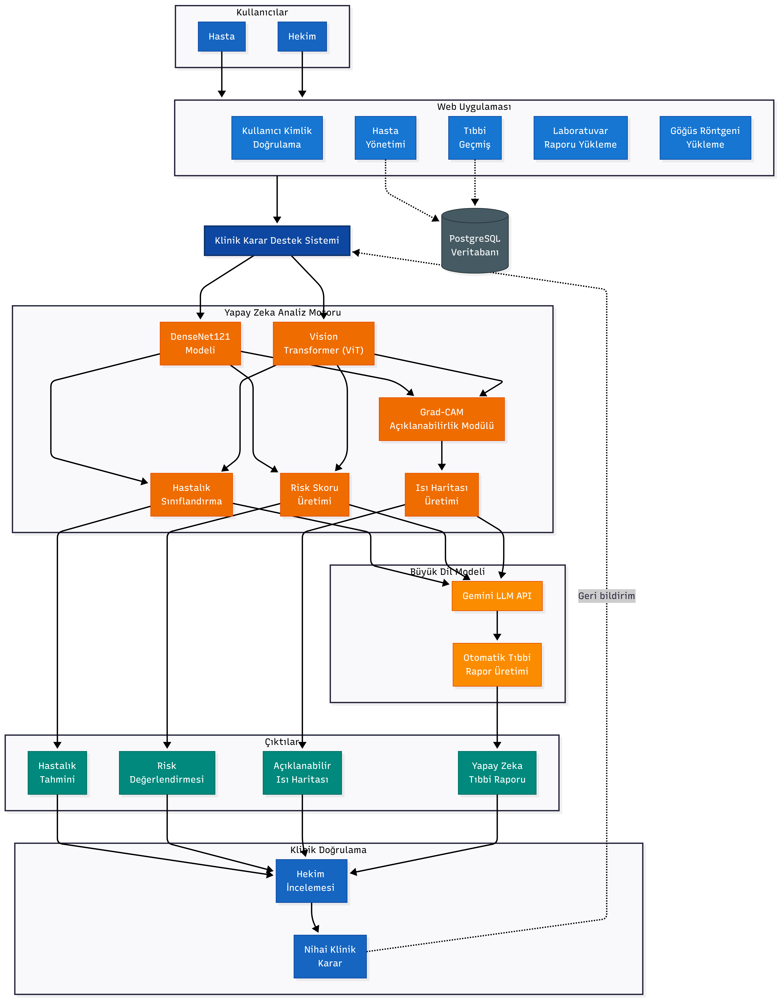

# Hekim — AI-Assisted Clinical Decision Support for Chest X-rays

A full-stack hospital web application in which doctors upload chest X-rays and get a second opinion from two deep-learning models: a CNN (DenseNet121) and a Vision Transformer (ViT). Each finding comes with a **Grad-CAM heat map** that shows where the model looked, and a **draft radiology report written by Google Gemini**. The doctor reviews everything and makes the final decision.

> **Not a medical device.** This is a research and portfolio project. Its predictions must not be used for diagnosis.

<!-- Add 2–3 screenshots here: doctor dashboard, X-ray analysis with heat map, generated report -->

## Contents

- [Features](#features)
- [Architecture](#architecture)
- [How it works](#how-it-works)
- [Model training and results](#model-training-and-results)
- [API overview](#api-overview)
- [Getting started](#getting-started)
- [Tests](#tests)
- [Project structure](#project-structure)
- [Known limitations](#known-limitations)

## Features

| Role | What they can do |
| --- | --- |
| **Patient** | Register, book and cancel appointments, view examination history, prescriptions, lab results (downloadable as PDF) and X-rays in a built-in image viewer |
| **Doctor** | Set weekly working hours and time off, run examinations, write diagnoses and prescriptions, enter lab results from templates, upload X-rays, run AI analysis, view heat maps, generate draft reports |
| **Admin** | Hospital statistics, add and remove doctors, view all patients and appointments |

- **14-disease multi-label classification** on the NIH ChestX-ray14 label set
- **Two-model fusion:** DenseNet121 and ViT-Base/16 combined into one probability per disease
- **Explainability:** Grad-CAM heat maps overlaid on the original X-ray
- **LLM reporting:** Gemini drafts a structured report from the clinical history and the findings the doctor selects
- **Security:** JWT authentication, bcrypt password hashing and role-based access control on every endpoint, covered by automated tests

## Architecture



The React frontend talks to a FastAPI backend over a JSON REST API. The backend stores everything in PostgreSQL, runs both neural networks in-process with PyTorch, and calls the Gemini API for report drafting.

| Layer | Technology |
| --- | --- |
| Frontend | React 19, Vite, html2pdf.js |
| Backend | FastAPI, SQLAlchemy 2, Pydantic 2 |
| Database | PostgreSQL 16 (Docker) |
| AI inference | PyTorch, torchvision (DenseNet121), Hugging Face Transformers (ViT), OpenCV |
| Model training | PyTorch on Kaggle; TensorFlow/Keras and PyTorch on Google Colab |
| LLM | Google Gemini API |

More design documents (in Turkish): [UML diagrams](docs/uml_diagrams.md), [data-flow diagrams](docs/data_flow_diagrams.md), [use-case diagram](docs/diagrams/use_case_diagram.png).

## How it works

### 1. Authentication and access control

1. A user logs in with email and password (`POST /api/auth/login`). The backend checks the doctors, patients and admins tables in turn and verifies the password against its **bcrypt hash**.
2. On success it returns a **JWT** signed with HS256 that contains the user's email and role (`doctor`, `patient` or `admin`). Tokens expire after 24 hours by default.
3. The frontend stores the token and sends it as `Authorization: Bearer <token>` on every request.
4. Every protected endpoint decodes the token, loads the user from the database, and applies two kinds of checks (`app/core/security.py`):
   - **Role checks** for whole areas: only admins reach `/api/admin/*`, only doctors reach `/api/ai/*`.
   - **Ownership checks** per record: a patient can only read and edit their own data, a doctor can only change their own profile and schedule, and only the doctor of an appointment can write its examination record or lab results.

Patients can register themselves. Doctors are created by an admin.

### 2. Scheduling and appointments

Each doctor defines working hours per weekday and a slot length (20 minutes by default), and can add **time off**, either a full day or a time range.

When a patient picks a doctor and a date, `GET /api/appointments/available-slots` builds the free slots like this:

1. Return nothing for weekends, past dates or a full day off.
2. Walk through the doctor's working hours for that weekday in steps of the slot length.
3. Drop slots that are already in the past (for today), that overlap a partial time-off range, or that are already booked by a non-cancelled appointment.

Booking creates the appointment with status **Onaylandı** (confirmed). The status then moves through the examination:

| Status | Set when |
| --- | --- |
| Onaylandı (confirmed) | Patient books |
| Devam Ediyor (in progress) | Doctor saves a draft examination record |
| Tamamlandı (completed) | Doctor completes the examination |
| İptal Edildi (cancelled) | Patient or doctor cancels |

A patient can only cancel; the doctor of the appointment (or an admin) can set any status.

### 3. Examination

During an appointment the doctor fills in an **examination record**: complaint, diagnosis, notes and prescribed medicines. Saving it again updates the same record, so a draft can be finished later. When medicines are entered, the system generates a prescription number (`REC` + 6 characters) that the patient later sees under *Prescriptions*.

From the same screen the doctor can:

- **Add lab results.** Choosing a template (e.g. a complete blood count) pre-fills the parameters with their units and reference ranges; the doctor enters the values. Results are stored as JSON and the patient can download them as a PDF report.
- **Upload an X-ray** and run the AI analysis described next.

### 4. X-ray analysis pipeline

```
Upload image ─► preprocess (224×224, ImageNet normalisation)
             ├─► DenseNet121 ─► 14 probabilities ─┐
             └─► ViT-Base/16 ─► 14 probabilities ─┴─► fusion (60% / 40%) ─► ranked findings
Doctor picks a disease ─► Grad-CAM on DenseNet ─► heat map over the X-ray
Doctor selects findings ─► Gemini ─► draft report ─► doctor edits ─► saved with the study
```

**Preprocessing.** The image is converted to RGB, resized to 224×224 and normalised with the ImageNet mean and standard deviation, the same transform used in training.

**Inference** (`POST /api/ai/analyze-xray`). Both models are loaded once, on the first request, and kept in memory (GPU if available, otherwise CPU).

- **DenseNet121**: torchvision's DenseNet121 with its classifier replaced by a 14-output linear layer; a sigmoid turns the outputs into independent per-disease probabilities (multi-label, so several diseases can be present at once).
- **ViT**: Google's `vit-base-patch16-224` backbone; the `[CLS]` token goes through dropout and a 14-output linear layer with a sigmoid.

**Fusion.** For each disease the API combines the two probabilities with a weighted average, 60% DenseNet and 40% ViT, and ranks the diseases by the fused probability. A disease is marked **detected** when the ViT probability reaches that disease's threshold. The 14 thresholds were chosen to maximise F1 for each disease (see notebook 03), which matters because the dataset is very imbalanced and a single 0.5 cut-off would miss rare diseases. The response includes both models' raw probabilities, the fused value, the threshold and the weights, so the doctor sees exactly how each number was produced.

**Grad-CAM heat map** (`POST /api/ai/gradcam`). For the disease the doctor selects:

1. Run the image through DenseNet121 and back-propagate that disease's output score.
2. Take the feature maps of the last DenseNet block (`norm5`) and the gradients flowing into them.
3. Average each channel's gradients to get one weight per feature map, sum the weighted maps, and keep only positive values (ReLU).
4. Resize the map to the original image size, scale it to 0–255, colour it with the JET colour map and blend it 40/60 over the X-ray.

The result is returned as a base64 JPEG and shows which regions drove the prediction.

**Report drafting** (`POST /api/ai/generate-report`). The doctor ticks the findings they agree with. The backend sends Gemini a prompt containing the patient's age and sex, the study type, the clinical complaint and only those selected findings with their percentages. The prompt tells the model to write as a radiologist, avoid definitive diagnoses ("suspicious for", "consistent with"), and use exactly three sections: clinical information, radiological findings, and conclusion and recommendation. The draft lands in an editable text box, so the doctor has the final word.

**Saving.** When the doctor saves the study, the image goes to `backend/uploads/` under a random file name, the radiology study is stored with the report, and the raw AI output is stored separately (`ai_analyses` table, as JSON with model name and version). The doctor's screen can later show the original AI analysis next to the final report.

### 5. Patient portal

Patients get an overview page, their full visit history with diagnoses and prescriptions, lab results with reference ranges (exportable to PDF), and their X-rays in a viewer with zoom, brightness, contrast and invert controls.

### 6. Admin panel

Admins see totals for doctors, patients and appointments, add doctors (with a hashed initial password), remove doctors, and browse all patients and appointments.

### Data model

| Table | Holds |
| --- | --- |
| `patients` | Identity and contact details, blood type, height and weight, allergies and chronic diseases (JSON lists) |
| `doctors` | Profile, specialty, slot length |
| `admins` | Admin accounts |
| `doctor_schedules` | Working hours per weekday |
| `doctor_timeoffs` | Full-day or partial time off |
| `appointments` | Patient, doctor, date, time, reason, status |
| `medical_records` | One per appointment: complaint, diagnosis, notes, medicines, prescription number |
| `lab_studies` | Lab results as JSON (parameter, value, unit, reference range, status) |
| `radiology_studies` | Image URL, modality, body part, report |
| `ai_analyses` | Raw model output (JSON) for a radiology study |

## Model training and results

Both models were trained on [NIH ChestX-ray14](https://www.kaggle.com/datasets/nih-chest-xrays/data) with a **patient-level split**, so no patient appears in more than one set (50,000-image subset: 36,000 train / 4,000 validation / 10,000 test). Scores are ROC AUC on the 10,000-image test set, from [`notebooks/04_fusion_evaluation.ipynb`](notebooks/04_fusion_evaluation.ipynb).

| Disease | DenseNet121 | ViT | Fusion |
| --- | ---: | ---: | ---: |
| Atelectasis | 0.761 | 0.761 | **0.768** |
| Cardiomegaly | 0.823 | 0.850 | **0.857** |
| Effusion | 0.823 | 0.829 | **0.838** |
| Infiltration | 0.661 | 0.678 | **0.681** |
| Mass | **0.762** | 0.746 | 0.750 |
| Nodule | 0.654 | 0.669 | **0.678** |
| Pneumonia | 0.662 | 0.688 | **0.692** |
| Pneumothorax | 0.819 | 0.831 | **0.841** |
| Consolidation | 0.762 | 0.774 | **0.783** |
| Edema | 0.849 | 0.859 | **0.865** |
| Emphysema | 0.834 | 0.833 | **0.856** |
| Fibrosis | 0.736 | 0.740 | **0.766** |
| Pleural thickening | 0.733 | 0.739 | **0.751** |
| Hernia | 0.818 | 0.851 | **0.857** |
| **Macro average** | 0.764 | 0.775 | **0.785** |

Fusion beats both single models on 13 of 14 diseases.

**How this relates to the running app.** The table uses the Keras DenseNet121 from notebook 02. The API serves a separately trained PyTorch DenseNet121 (notebook 01; validation macro AUC 0.832 at the epoch used, see [`notebooks/results`](notebooks/results/densenet121_pytorch_val_auc_by_epoch.csv)) together with the ViT, combined with the fixed 60/40 weighting described above. That deployed combination has not been re-scored on the test set.

| Notebook | What it does |
| --- | --- |
| [`01_densenet121_pytorch_training`](notebooks/01_densenet121_pytorch_training.ipynb) | DenseNet121 (PyTorch, ImageNet-pretrained) trained on Kaggle; the model the API serves |
| [`02_densenet121_keras_training`](notebooks/02_densenet121_keras_training.ipynb) | DenseNet121 (TensorFlow/Keras) on the 50k patient-level split |
| [`03_vit_training`](notebooks/03_vit_training.ipynb) | ViT-Base/16 fine-tuning, attention maps, per-disease F1-optimal thresholds |
| [`04_fusion_evaluation`](notebooks/04_fusion_evaluation.ipynb) | Compares DenseNet, ViT and fusion on the test set |

The notebooks read the dataset from Kaggle or Google Drive paths; adjust them to run elsewhere.

## API overview

Interactive documentation is available at `http://localhost:8000/docs` once the backend is running.

| Area | Main endpoints | Who |
| --- | --- | --- |
| Auth | `POST /api/auth/login`, `POST /api/auth/register/patient` | Public |
| Patients | `GET/PUT /api/patients/{id}` | Owner; doctors and admins can read |
| Doctors | `GET /api/doctors/`, `PUT /api/doctors/{id}`, `/schedule`, `/timeoff` | Any user reads; owner edits |
| Appointments | `POST /api/appointments/`, `GET /available-slots`, `/patient/{id}`, `/doctor/{id}`, `PUT /{id}` | See [section 2](#2-scheduling-and-appointments) |
| Medical records | `POST /api/medical-records/`, `GET /patient/{id}`, `/doctor/{id}`, `/appointment/{id}` | Appointment's doctor writes |
| Lab studies | `POST /api/lab-studies/`, `GET /patient/{id}` | Appointment's doctor writes |
| Radiology | `POST /api/radiology/upload`, `GET /patient/{id}`, `/doctor/{id}` | Doctors upload |
| AI | `POST /api/ai/analyze-xray`, `/gradcam`, `/generate-report` | Doctors |
| Admin | `GET /api/admin/stats`, `/doctors`, `/patients`, `/appointments`, `POST/DELETE /doctors` | Admins |

## Getting started

**Requirements:** Python 3.10+, Node.js 20.19+, Docker.

### 1. Database

```bash
docker compose up -d
```

### 2. Backend

```bash
cd backend
python -m venv venv
source venv/bin/activate          # Windows: .\venv\Scripts\activate
pip install -r requirements.txt

cp .env.example .env              # Windows: copy .env.example .env
```

Open `backend/.env` and set at least `SECRET_KEY` (generate one with `python -c "import secrets; print(secrets.token_hex(32))"`). For the AI features, also set `GEMINI_API_KEY` and the model weight paths (below).

```bash
python seed_db.py                 # creates tables and demo data (wipes the database!)
uvicorn app.main:app --reload     # API on http://localhost:8000
```

### 3. Frontend

In a second terminal, from the project root:

```bash
npm install
npm run dev                       # http://localhost:5173
```

To point the frontend at a different API, create a `.env` file in the project root with `VITE_API_URL=https://your-api`.

### Demo accounts (created by `seed_db.py`)

| Role | Email | Password |
| --- | --- | --- |
| Admin | `admin@hekim.com` | `admin123` |
| Doctor | `doktor1@hekim.com` … `doktor15@hekim.com` | `password123` |
| Patient | `hasta1@hekim.com` … `hasta40@hekim.com` | `password123` |

These are for local demos only. All demo data is generated with Faker.

### Model weights

The trained weights are too large for git. Download them from **[ADD LINK — e.g. Hugging Face Hub or a GitHub Release]**, put them in `backend/weights/`, and check the paths in `backend/.env`:

```
DENSENET_WEIGHTS_PATH=weights/densenet121_nih.pth
VIT_WEIGHTS_PATH=weights/vit_nih.pt
```

Without the weights, the rest of the application works and the AI endpoints return a clear error message.

## Tests

The tests cover login, password hashing and role-based access control (19 tests). They run against the database configured in `backend/.env`, create their own users and remove them afterwards.

```bash
cd backend
pytest
```

## Project structure

```
├── backend/
│   ├── app/
│   │   ├── core/         # settings, database, auth and role checks
│   │   ├── models/       # SQLAlchemy tables
│   │   ├── schemas/      # Pydantic request/response models
│   │   └── routers/      # API endpoints (auth, patients, doctors, appointments, AI, …)
│   ├── tests/
│   └── seed_db.py        # demo data
├── src/                  # React frontend
├── notebooks/            # model training and evaluation
└── docs/                 # UML, data-flow and architecture diagrams
```

## Known limitations

- Uploaded X-ray images are served as public static files (`/uploads/...`) so the browser can display them; a production system would serve them through an authenticated endpoint.
- The raw AI analysis is hidden from patients in the interface, but the patient's radiology API response still includes it.
- Doctors can view any patient's record, not only their own patients'.
- The frontend stores the JWT in `localStorage`.
- The deployed fusion (fixed weights, ViT-only thresholds) differs from the evaluated one; see [Model training and results](#model-training-and-results).
