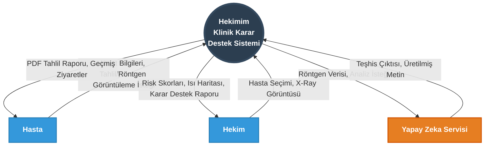
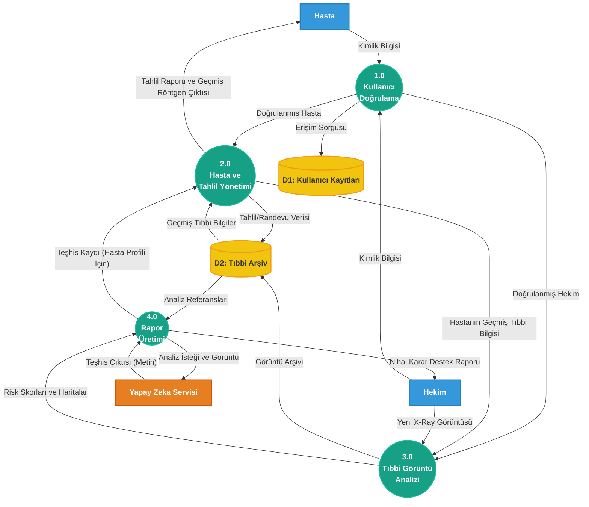

# Veri Akış Şemaları (DFD) Serisi

Sistemin üç farklı seviyedeki Veri Akış Şemaları (DFD). Diyagramlar Mermaid formatındadır; GitHub bunları doğrudan görüntüler.

---

## Kavramsal Veri Akış Şeması (Level 0 DFD)
*Sisteme dışarıdan kuş bakışı bakar. Sadece dış varlıklar ve ana sistemi gösterir.*



---

## Mantıksal Veri Akış Şeması (Level 1 DFD)
*Sistemin içine girer ve teknolojiden bağımsız olarak ana iş akışlarını ve veri depolarını gösterir.*



---

## Fiziksel Veri Akış Şeması (Physical DFD)
*Mantıksal akışların teknik olarak (PostgreSQL, React, JWT vb.) nasıl yapıldığını gösteren mimari harita.*

```mermaid
graph TD
    classDef process fill:#8e44ad,stroke:#9b59b6,stroke-width:2px,color:#fff,font-weight:bold
    classDef datastore fill:#e74c3c,stroke:#c0392b,stroke-width:2px,color:#fff,font-weight:bold
    classDef entity fill:#2c3e50,stroke:#34495e,stroke-width:2px,color:#fff,font-weight:bold

    %% Dış Cihazlar / İstemciler
    HastaApp[Hasta Tarayıcısı\n(React SPA)]:::entity
    HekimApp[Hekim Tarayıcısı\n(React SPA)]:::entity
    GeminiAPI[Google Gemini API]:::entity

    %% Sunucu Süreçleri (FastAPI)
    AuthServer((1.0\nJWT Auth Sunucusu\n(FastAPI))):::process
    LabServer((2.0\nLaboratuvar API\n(Stateless JWT Verify))):::process
    VisionEngine((3.0\nCNN/ViT Motoru\n(Stateless JWT Verify))):::process
    ReportEngine((4.0\nLLM Rapor Motoru\n(FastAPI))):::process
    
    %% İstemci Taraflı Süreç (HATA DÜZELTMESİ)
    PDFRenderer((İstemci PDF\nOluşturucu\nhtml2pdf.js)):::process

    %% Fiziksel Depolar
    DB[(D1: PostgreSQL DB\ndoctor_patient_db)]:::datastore
    Storage[(D2: Local File System\n/uploads)]:::datastore

    %% Akışlar
    HastaApp -- "POST /api/auth\n(Email/Pass)" --> AuthServer
    HekimApp -- "POST /api/auth\n(Email/Pass)" --> AuthServer
    AuthServer -- "Bearer Token (JWT)" --> HastaApp
    AuthServer -- "Bearer Token (JWT)" --> HekimApp
    AuthServer -- "SQL SELECT" --> DB
    
    HastaApp -- "GET /api/lab-studies\n+ HTTP Bearer" --> LabServer
    LabServer -- "JSON Tahlil Verisi" --> PDFRenderer
    PDFRenderer -- "PDF Rapor Dosyası" --> HastaApp
    LabServer -- "SQL SELECT/INSERT" --> DB
    
    HekimApp -- "POST /api/radiology\n(multipart/form-data)" --> VisionEngine
    VisionEngine -- "Save .jpg/.png & Heatmap" --> Storage
    VisionEngine -- ".pt / .h5 Inference" --> ReportEngine
    ReportEngine -- "Read Heatmap URL" --> Storage
    
    ReportEngine -- "HTTP POST\n(Image URL + Prompt)" --> GeminiAPI
    GeminiAPI -- "JSON (LLM Text)" --> ReportEngine
    ReportEngine -- "SQL INSERT (Analysis)" --> DB
    ReportEngine -- "JSON (Score + Heatmap URL + Text)" --> HekimApp
```
