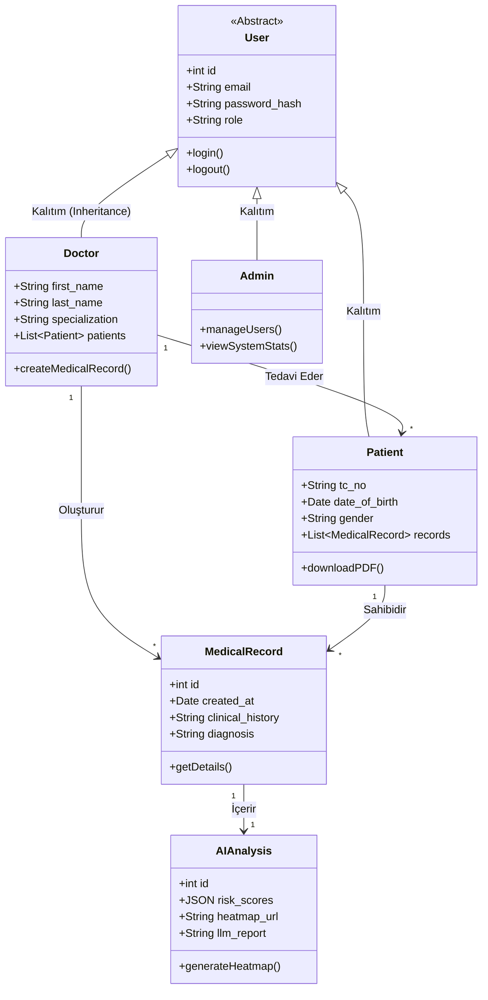
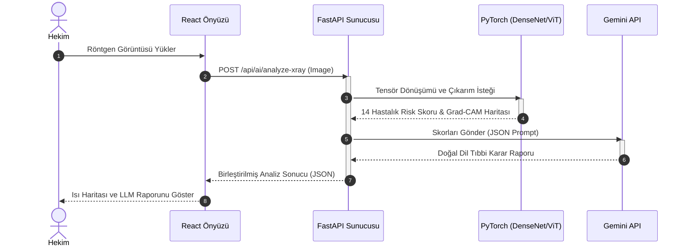

# UML Tasarım Diyagramları

Sistemin yapısal nesnelerini ve işleyiş adımlarını modellemek amacıyla, yazılım mimarisi tasarımında uluslararası standart olan UML (Unified Modeling Language) kullanılmıştır. Projenin karmaşık yapısını daha iyi ifade edebilmek adına, statik yapıyı göstermek için "Sınıf Diyagramı (Class Diagram)", dinamik yapay zeka analiz akışını göstermek için ise "Sıra Diyagramı (Sequence Diagram)" tercih edilmiştir.

## Sınıf Diyagramı (Class Diagram)

Sistemdeki veritabanı tablolarının nesne yönelimli (Object-Oriented) karşılıkları olan Modeller ve bu nesneler arasındaki kalıtım/ilişki yapıları Sınıf Diyagramı ile şematize edilmiştir. 
Sistemin merkezinde bulunan soyut (Abstract) "User" nesnesi; Doctor, Patient ve Admin sınıflarına kalıtım vermektedir. Doktorlar, kendi hastalarına muayene kaydı (Medical Record) oluştururken, bu kayıtlar kendi içerisinde yapay zeka analiz sonuçlarını (AI Analysis) barındırmaktadır.

---

## Sıra Diyagramı (Sequence Diagram)

Sistemin en kritik iş süreci olan "Yapay Zeka Destekli Radyoloji Analizi", bir Sıra Diyagramı ile zamansal boyutta modellenmiştir. 
Bu diyagramda; hekimin arayüze röntgen yüklemesiyle başlayan sürecin arka plan API'ye iletilmesi, PyTorch destekli modelin analiz ve ısı haritası (Grad-CAM) oluşturması, ardından bu sayısal sonuçların Gemini LLM API'ye gönderilerek doğal dilde tıbbi rapora çevrilmesi ve son olarak tüm sürecin birleştirilip hekimin arayüzüne (React) döndürülmesi adım adım gösterilmiştir.

